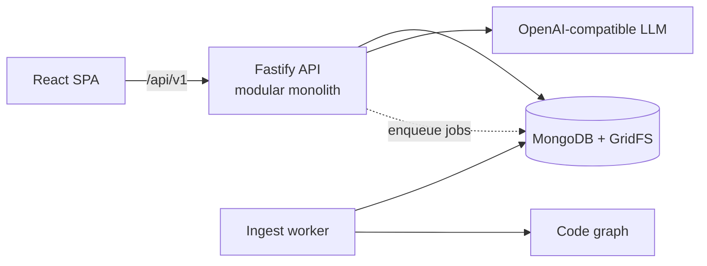

# codex-sage

Multi-tenant SaaS enterprise software intelligence platform: connect or upload project
source and documentation → build project knowledge → grounded chat answers with
inspectable evidence.

> A personal project exploring how LLMs can answer questions about a real codebase with
> grounded, verifiable evidence, built as a production-style Node.js system.

## Features

- **Multi-tenant by design**: organizations, projects, roles and per-route authorization; cross-tenant access returns 404.
- **Knowledge ingestion**: connect a repository or upload source/docs; a background worker ingests content and builds a code graph.
- **Grounded AI chat**: answers cite inspectable evidence from the project, with agent tools and context/token budgeting.
- **Works with any OpenAI-compatible LLM endpoint** via the Vercel AI SDK.
- **Security**: argon2id passwords, JWT with rotating httpOnly refresh cookies, CSRF protection, encrypted secrets, audit logging.
- **Reliable background jobs**: MongoDB-backed queue with leases, heartbeats, an expired-lease sweeper, retries and per-project locks (no Redis).

## Tech stack

| Layer    | Technologies                                                              |
| -------- | ------------------------------------------------------------------------- |
| Backend  | Node.js (ESM, plain JavaScript), Fastify 5, Zod, Pino                     |
| Data     | MongoDB 8 (replica set), Mongoose, GridFS                                 |
| AI       | Vercel AI SDK (OpenAI-compatible), code-graph analysis                    |
| Frontend | React 19, Vite, TanStack Query, React Router, Radix UI, Tailwind, i18next |
| Quality  | Vitest (coverage), ESLint, Prettier, Husky                                |

## Architecture



The API is a modular monolith with **access** (auth, permissions, audit), **knowledge**
(repo sync, uploads, ingestion, code graph, search), **conversation** (LLM, agent tools,
context budgeting) and **masters** (organizations, projects, roles, users, jobs) modules.
In production a single Fastify process serves both the API and the built SPA.

Key design decisions are recorded as Architecture Decision Records in [docs/adr](./docs/adr).

## Built with AI-assisted development

Developed with Cursor, guided by project-wide engineering rules in `.cursor/rules`
(API, database, security, testing and error-handling standards) and [AGENTS.md](./AGENTS.md).

## Prerequisites

- **Node.js >= 26**
- **npm** (bundled with Node.js)
- **MongoDB 8 replica set** for local development — see [docs/mongodb-setup.md](./docs/mongodb-setup.md)

## Quick start

```bash
npm run setup   # check Node, bootstrap .env files, install deps
npm run dev     # API :3000 + worker + frontend Vite (proxies /api → :3000)
```

### First run (backend)

With Mongo reachable and `MONGODB_URI` set, starting the API connects, syncs indexes in
non-production, and runs an idempotent bootstrap seed (default organization, built-in roles,
invited admin). One `info` log line reports `bootstrap seed succeeded` with
`result: created | already_present`. Use `LOG_LEVEL=debug` for per-step seed detail. There is
no `npm run bootstrap` CLI and no `BOOTSTRAP_*` env vars (see ADR 0011).

## Commands

All root commands operate on **both** `backend/` and `frontend/`.

| Command                       | What it does                                                                                                                                            |
| ----------------------------- | ------------------------------------------------------------------------------------------------------------------------------------------------------- |
| `npm run setup`               | Verify Node >= 26, copy `.env.example` → `.env` only if missing (apps + `tests/e2e/`), then install                                                     |
| `npm run install`             | `npm ci` per app when a lockfile exists; otherwise `npm install`                                                                                        |
| `npm run dev`                 | Dev servers: backend API (`node --watch`, **:3000**), ingest worker, and frontend (Vite; `/api` proxied to **:3000**)                                   |
| `npm run build`               | Production builds: backend (no-op; plain JavaScript) and frontend (`vite build`)                                                                        |
| `npm run start`               | Production run: one Fastify process serves `/api/v1` and the built SPA (`frontend/dist`); requires a prior `npm run build`                              |
| `npm run test`                | Vitest with coverage in both apps                                                                                                                       |
| `npm run lint`                | ESLint in both apps                                                                                                                                     |
| `npm run measure-llm-context` | Measure OpenAI-compatible context capacity and tokenizer-parity fixtures; writes `docs/evaluation/phase-43-context.md`. See `docs/evaluation/README.md` |
| `npm run clean`               | Remove `node_modules`, `dist`, and `coverage` in both apps (prompts; use `npm run clean -- --yes` to skip)                                              |

You can also run the scripts directly:

```bash
bash scripts/setup.sh
bash scripts/dev.sh
bash scripts/clean.sh --yes
```

## Layout

- `backend/` — Node.js API + workers (Fastify), plain JavaScript
- `frontend/` — React app (Vite), plain JavaScript / JSX
- `scripts/` — root setup / install / run helpers
- `docs/` — architecture, local MongoDB setup, and ADRs

See [AGENTS.md](./AGENTS.md) for repo conventions.
